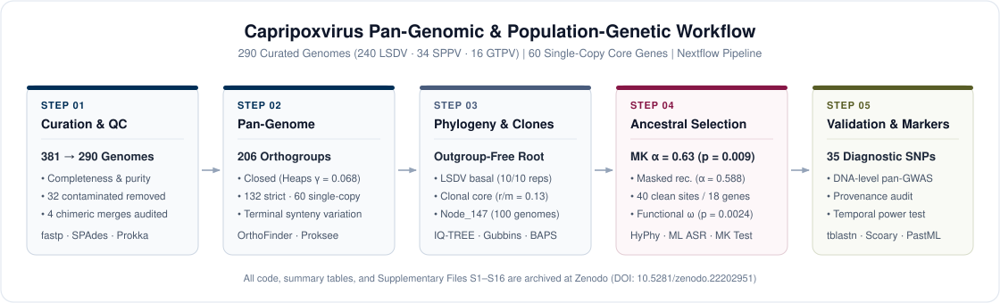

<p align="center">
  
</p>

<p align="center">
  <a href="https://www.nextflow.io/"></a>
  <a href="https://docs.conda.io/"></a>
  <a href="https://sylabs.io/"></a>
  <a href="https://doi.org/10.5281/zenodo.24420766"></a>
  <a href="LICENSE"></a>
</p>

---

## What this pipeline does

Capripoxviruses have large, slowly evolving double-stranded DNA genomes, and
that creates a specific analytical problem: the tools normally used to detect
selection assume there is enough synonymous variation to calibrate against.
Within Lumpy Skin Disease Virus there is not. Across 240 LSDV genomes the median
core gene carries **six distinct protein sequences**, synonymous rates collapse
towards zero at 88–96% of sites, and 30 of 56 testable genes return a
likelihood-ratio statistic of exactly zero.

This pipeline is built around that constraint. It reconstructs the pangenome,
infers the genus root without an outgroup, maps recombination and population
structure, validates accessory-genome associations at the nucleotide level, and
runs codon-model scans **as a diagnostic** alongside a population-genetic
framework — a polarised, recombination-masked McDonald–Kreitman test — that
remains interpretable without intra-population synonymous variation.

| Stage | What it answers |
|---|---|
| `01–04` Read QC, depletion, assembly, annotation | What is actually viral sequence, and what is host or bacterial carry-over |
| `05–06` Proteome QC, chimerism audit & pangenome | How large is the core, how closed is the repertoire, and how gene content evolves |
| `07–08` Supermatrix, ML phylogeny & non-reversible rooting | Does genomic structure follow host species, and where does the ingroup root lie |
| `09–10` Recombination and Bayesian clustering | Are circulating recombinants one lineage or many independent events |
| `11–12` Phylogeography and temporal power analysis | Can origin and timing be inferred, or do sampling bias and window width forbid it |
| `13` Pan-GWAS, `tblastn` validation & diagnostic SNPs | Do accessory associations reflect biology or provenance, and which core sites diagnose lineages |
| `14–16` Selection scans, functional constraint & MK test | Where and when did adaptation occur, and how is constraint structured by gene function |

## Quick start

```bash
# 1. install Nextflow
curl -s [https://get.nextflow.io](https://get.nextflow.io) | bash

# 2. check the wiring on the bundled synthetic data (seconds, no tools needed)
nextflow run RaanaT1375/capripoxvirus-pangenome -profile test -stub-run --outdir results_test

# 3. run for real
nextflow run RaanaT1375/capripoxvirus-pangenome \
    -profile slurm,singularity \
    --input samplesheet.csv \
    --outdir results \
    --host_bowtie2_index /path/to/host_indices \
    --bacteria_mmi /path/to/Bacteria_Representative_DB.mmi
